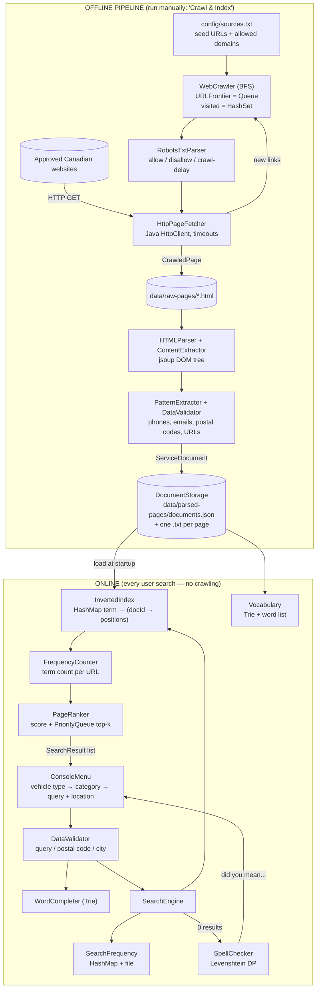

# CarCare+ — Complete Project Plan (COMP 8547, Fall 2026)

> Status: **PLANNING ONLY — no code written yet.**
> Sources of truth: `Final Project Information.pdf` (3 pages, "Info") and `Final Project Grading.pdf` (5 pages, "Rubric").
> Website checks in §10 were performed on **2026-10-31** and must be re-checked before the real crawl.

---

## 1. Assignment Analysis

### 1.1 Exact requirements (with page references)

| # | Requirement | Where |
|---|---|---|
| R1 | Group of **4–5 students (recommended)**; members **evaluated individually** and may get different marks | Info p.1 "Guidelines" |
| R2 | Apply class concepts to build a **real system**; evaluate it with analysis methods; "use of **Java and Eclipse**" | Info p.1 "Goals" |
| R3 | A **back-end** application using **three to five different concepts** from class | Info p.1 "Description" |
| R4 | Variant proposal must state project name, idea, **how all mandatory features are implemented and who implements them** | Info p.1 Instr. 1 |
| R5 | All code in **Java** | Info p.1 Instr. 2 |
| R6 | GUI not required and **cannot be counted as a feature** | Info p.1 Instr. 3 |
| R7 | Minimum features, **each student implements 1–2**: web crawler, HTML parser, spell checking, word completion, frequency count, search frequency, page ranking, inverted indexing, regex data validation, regex pattern finding | Info p.1 Instr. 4 |
| R8 | Spell checking: vocabulary built from **all words in the text files**; **alternative suggestions when no results are found**; edit distance may be used | Info p.1 |
| R9 | Frequency count: occurrences of a word **in a specific URL** | Info p.1 |
| R10 | Search frequency: show **previously searched words and how many times** each was searched | Info p.1 |
| R11 | Page ranking: importance **based on number of occurrences**; more repetitions → higher rank; sorting/heaps/other DS | Info p.1 |
| R12 | Inverted index: map from content (words/numbers) to **locations in a set of documents** | Info p.1 |
| R13 | Sample variants: crawl **3–5 websites**, **each team member crawls a different provider**; data extraction, comparison, recommendation | Info p.2 |
| R14 | Variant need not match samples but **must include the mandatory features** | Info p.2 footnote |
| R15 | Report: group/members/variant (copy the task), **each member's contribution with Java file names**, additional features, DS/algorithm description per feature, **screenshots of each feature**, references | Info p.3 |
| R16 | Presentation: same elements + explanation + **live demo**; **7–10 minutes incl. demo**; Q&A for **each student** | Info p.3 |
| R17 | Deadlines: group Sept 22; variant Sept 29; **Milestone Report I ≈ Week 5 (10% penalty if missing)**; report + presentation in **Week 11/12** class | Info p.3 |

### 1.2 Grading rubric (total /26)

| Criterion | Type | Points | Page | What "Excellent" needs |
|---|---|---|---|---|
| Feature Development | Personal | 3 | Rubric p.1 | **Web crawler + two other features**, high complexity |
| Question Answering | Personal | 3 | p.2 | Precise, clear answers; don't dump code unasked |
| Presentation & Delivery | Personal | 3 | p.2 | Clear, structured, engaging |
| Error Handling | Personal | 3 | p.3 | Robust error handling **in your own features** |
| Teamwork | Group | 3 | p.3 | Seamless integration; **every member fluent**; **equal work distribution** |
| Data Structure Variety | Group | 3 | p.4 | Diverse DS tailored to each requirement |
| Testing | Group | 3 | p.4 | Thorough scenario coverage |
| Creativity & Innovation | Group | 3 | p.4 | Sets project apart |
| Timing | Group | 1 | p.4 | Within the limit (±1 min) |
| Week-11 defence bonus | Group | 1 | p.5 | Present in Week 11, not 12 |

Personal = 12/26 (46%). Bands: Excellent ≥ 23, Good ≥ 20, Satisfactory ≥ 15 (Rubric p.5).

**Zero-score triggers (Rubric p.1–3):** a student who did only the GUI, or only the report/presentation, scores 0 on Feature Development, Q&A and Error Handling.

### 1.3 Discrepancies and ambiguities

| ID | Issue | Evidence | Implication |
|---|---|---|---|
| D1 | **"1–2 features per student" vs "web crawler + two other features"** | Info p.1 vs Rubric p.1 | Rubric expects **3 units per student, one being a crawler**. Doing only 1–2 features caps you at 2/3. |
| D2 | "Three to five concepts" vs a list of **10 minimum features** | Info p.1 Description vs Instr. 4 | Build all 10 — safest reading. |
| D3 | Crawler is listed once in the feature list, but rubric wants a crawler **per student** | Info p.1 / p.2 / Rubric p.1 | Info p.2 explains it: **each member crawls a different website**. Plan: shared BFS engine + each member owns one source (seed config, site-specific extraction, crawl run, tests). |
| D4 | Rubric calls a web crawler a possible "minor feature" | Rubric p.1 (1-pt column) | A trivial crawler won't earn complexity credit; make yours non-trivial (BFS, robots.txt, politeness, normalization). |
| D5 | "Use of Java **and Eclipse**" | Info p.1 Goals | IDE may be expected. Maven projects import directly into Eclipse — keeps both options open. **Ask.** |
| D6 | Timing: "deducted if > 10 or < 7 min" vs "within 1-min variation" / "beyond 10 minutes" | Info p.3 vs Rubric p.4 | Target **8–9 min** to be safe on both readings. |
| D7 | Week-11 bonus attached to report row (Info) vs "defending the project in Week 11" (Rubric) | Info p.3 vs Rubric p.5 | Aim for Week 11; confirm what must be submitted that day. |
| D8 | Testing is a **group** score; error handling is **personal** | Rubric p.3–4 | Every member needs error handling in *their own* classes. |
| D9 | Frequency count is **per URL**, not per corpus | Info p.1 | `countInDocument(word, url)` is a required API. |
| D10 | Spell suggestions are required **when no results are found** | Info p.1 | Search engine must trigger the spell checker on zero hits. |
| D11 | Page ranking is **occurrence-based**, not Google PageRank | Info p.1 | Our weighted score must remain an occurrence count at its core. |
| D12 | "Recommendation" / "comparison" appear only in samples | Info p.2 footnote | Optional; good for Creativity points. |

### 1.4 Teamwork, individual grading and AI use — read this carefully

You have five members but plan to implement most of it yourself with AI help. Consequences under the rubric:

1. **Other members:** if they don't develop features, the rubric gives them **0 on Feature Development, Q&A and Error Handling** (Rubric p.1–3) — 9 of 26 points each.
2. **Teamwork (group, /3):** "equal distribution of work" and "each team member should demonstrate their proficiency" (Rubric p.3). One person building everything caps this at 1–2 points **for everyone, including you**.
3. **Report honesty:** the report must list each member's Java files (Info p.3). Contributions must be listed as they really happened. **I will not write contribution text that attributes work to people who didn't do it.**
4. **AI assistance:** the PDFs don't mention generative AI. Check the course outline / Brightspace for the COMP 8547 AI policy and the University of Windsor academic integrity rules. If AI help is allowed, **disclose it** in the report the way the instructor requires. In every case, you must be able to explain every line you submit — the Q&A is individual.
5. **Recommendation:** get the other four members to really own a source + two features each (template in §11.3). My role: explain, review and generate code **for whoever is building that module**, who then studies, tests and defends it.

---

## 2. Project Evaluation

**Verdict: CarCare+ fits the assignment well.** It is a search problem over crawled web content, which is exactly what the 10 features are about, and it has a real Canadian use case (good for Creativity).

Adjustments:

| Original idea | Adjustment | Reason |
|---|---|---|
| Register / log in | **Drop** (optional in-session "profile": name, vehicle type, location) | Earns no marks; adds password-security risk |
| Detect current location | **Drop**; user types city, province or postal code (validated by regex) | No GPS on a console backend |
| Distance / ETA | **Optional stretch**: straight-line (Haversine) distance only if a page contains coordinates. **No ETA.** | Needs routing APIs; would be invented data otherwise |
| Live availability, booking, payments, ratings | **Future work** — mention in report only | Out of scope; ratings only if a reliable source has them |
| EV manufacturer/model list | Small curated config file (`config/ev-models.txt`), clearly labelled as curated | Not a graded feature; keeps the EV branch working |
| Search by many sources | **3–5 compliant sources** (§10) | Matches Info p.2 |
| "Recommendation" | Rank results filtered by vehicle type + category + location match | Creativity; reuses ranking |

Primary demo story: *"I'm in Abbotsford, BC, my EV won't charge / my battery is dead — what's nearby?"* → shows spell check, completion, index search, ranking, frequency, regex-extracted phone numbers, and search history.

---

## 3. Final Feature Scope

Crawler + 4 feature groups = all **10** listed features (+1 optional extra).

| Module | Assignment features covered | Info p.1 item |
|---|---|---|
| **M1 Web Crawler** | Web crawler (BFS, robots.txt, politeness) | Crawler |
| **M2 HTML Parser** | HTML parser | Parser |
| **M3 Search Engine** | Inverted indexing · Frequency count · Search frequency · Page ranking | 4 features |
| **M4 Query Assistance** | Word completion · Spell checking | 2 features |
| **M5 Regex Engine** | Data validation · Pattern finding | 2 features |
| *Extra (optional)* | Service recommendation filter (vehicle type / category / location) | Creativity |

---

## 4. Architecture



Key rule: **crawling and indexing are separate from searching.** The crawler runs only when chosen from the menu (or via a separate command); searches use stored documents loaded at startup.

---

## 5. Complete Workflow

**A. Offline (once per data refresh)**
1. Read `config/sources.txt` → seed URLs, allowed domain, max depth, max pages, source name.
2. For each source: download and parse `robots.txt`; obey `Disallow` and `Crawl-delay` (min 2 s default).
3. BFS: dequeue URL → skip if visited/disallowed/off-domain/too deep → fetch with timeout → on HTTP 200 + `text/html`, save raw HTML and extract links → normalize links → enqueue unseen ones at `depth+1`. Stop at `maxPages`.
4. Parser turns each raw page into a `ServiceDocument`: title, meta description, headings, cleaned body text, links (scripts/styles/nav removed).
5. Regex: extract phones, emails, postal codes; validate each; normalize phones to `(XXX) XXX-XXXX`; derive province from postal code first letter.
6. Categorize: keyword → `ServiceCategory` (e.g. "battery", "alternator" → BATTERY_ELECTRICAL); tag `VehicleType` (EV if source is a charging network or text has EV terms).
7. Save documents (JSON + one `.txt` file per document — the "text files" for the spell-check vocabulary, R8). Duplicate URLs or identical content hashes are skipped.

**B. Startup**
8. Load documents → build `InvertedIndex` (tokenize with the shared `Tokenizer`) → build vocabulary `Trie` with word frequencies → load search history file.

**C. Each search**
9. User picks vehicle type → category (filtered by type) → types a query and location.
10. Validate input (length, allowed characters, postal code format).
11. While typing a prefix, the user may ask for completions (Trie).
12. Record each query term in `SearchFrequency`.
13. Look up terms in the index → candidate documents → filter by vehicle type / category / location.
14. If **no results**: spell-check each unknown term → "Did you mean …?" → offer re-search (R8/D10).
15. Score candidates by occurrence counts (weighted by where they occur) → top-k with `PriorityQueue`.
16. Display: rank, score + breakdown, title, source, URL, phones/emails/postal code, per-term frequency in that URL.

---

## 6. Technology Stack

| Item | Choice | Notes / approval |
|---|---|---|
| JDK | **Java 21 LTS** (Homebrew `openjdk@21`) | Machine currently has **only JDK 11** → must install 21 (or ask whether the lab uses 17) |
| Build | **Maven 3.9+** | Not installed yet. Maven projects import into Eclipse → handles D5 |
| IDE | VS Code + "Extension Pack for Java" | Already installed. **Ask the instructor** whether Eclipse is required (D5) |
| HTML parsing | **jsoup** (latest 1.x, pinned in Phase 1) | **Ask for approval.** We write our own extraction logic on top of jsoup's DOM (heuristics, cleaning, service extraction) so the parser feature isn't "just a library call" |
| HTTP | `java.net.http.HttpClient` (built-in) | No dependency |
| Persistence | **Gson** (JSON) + plain `.txt` files | One small dependency; alternative is our own TSV format if libraries are restricted |
| Testing | **JUnit 5 (Jupiter)** via Maven Surefire | Optional: JaCoCo coverage report for the Testing criterion |
| Logging | `java.util.logging` (built-in) | No dependency |
| VCS | Git + private GitHub repo | Per-member commits = evidence of contribution |
| Not used | Spring Boot, React, Docker, databases, microservices | No requirement justifies them |

---

## 7. Project Folder Structure

Root = this folder (`Car Care plus+/`). Changes from your draft are marked **★** with the reason.

```
Car Care plus+/
├── pom.xml
├── README.md
├── .gitignore                         ★ keeps data/raw-pages and target/ out of Git
├── docs/
│   └── PROJECT_PLAN.md                ★ this file; progress tracker (§11)
├── config/
│   ├── sources.txt                    seed URL | domain | maxDepth | maxPages | sourceName
│   ├── categories.txt                 ★ keyword → ServiceCategory mapping (not hard-coded)
│   └── ev-models.txt                  ★ curated EV brand/model list (labelled as curated)
├── data/
│   ├── raw-pages/<source>/*.html
│   ├── parsed-pages/documents.json  + *.txt
│   └── search-history.txt             ★ persisted search frequency
└── src/
    ├── main/java/ca/carcareplus/
    │   ├── app/        Main.java, ConsoleMenu.java ★, CrawlPipeline.java ★
    │   ├── crawler/    WebCrawler.java, URLFrontier.java, CrawlConfig.java,
    │   │               UrlNormalizer.java ★, RobotsTxtParser.java ★,
    │   │               PageFetcher.java ★ (interface), HttpPageFetcher.java ★, FetchResult.java ★
    │   ├── parser/     HTMLParser.java, ContentExtractor.java, ServiceCategorizer.java ★
    │   ├── validation/ DataValidator.java, PatternExtractor.java, RegexPatterns.java ★
    │   ├── storage/    DocumentStorage.java
    │   ├── search/     Tokenizer.java ★, InvertedIndex.java, FrequencyCounter.java,
    │   │               SearchFrequency.java, PageRanker.java, SearchEngine.java
    │   ├── query/      Trie.java, TrieNode.java ★, WordCompleter.java,
    │   │               LevenshteinDistance.java, SpellChecker.java
    │   ├── models/     CrawledPage.java, ServiceDocument.java, SearchRequest.java,
    │   │               SearchResult.java, VehicleType.java ★, ServiceCategory.java ★
    │   └── exceptions/ CrawlException.java ★, ParseException.java ★,
    │                   StorageException.java ★, InvalidInputException.java ★
    └── test/
        ├── java/ca/carcareplus/<same packages>/*Test.java   ★ mirrored packages
        └── resources/html/*.html                             ★ test fixtures (was data/test-html)
```

Why the ★ changes:
- **`PageFetcher` interface**: crawler tests use a fake fetcher returning 404/403/timeouts on demand — deterministic tests without touching the internet.
- **`RobotsTxtParser`**: robots compliance is a stated requirement and adds real crawler complexity (D4).
- **`UrlNormalizer`**: without it, `…/brakes`, `…/brakes/` and `…/brakes#top` count as three pages.
- **`Tokenizer`**: one shared normalization so the index, Trie and spell checker all agree on what a "word" is.
- **`RegexPatterns`**: every pattern compiled once in one place; parser and validator share them.
- **`exceptions/`**: separates recoverable failures (one bad page) from fatal ones (no config file).
- **Mirrored test packages + `src/test/resources`**: Maven convention; tests can access package-private helpers.
- **`ConsoleMenu` separate from `Main`**: keeps `Main` tiny; the menu is presentation only (GUI earns no marks — R6).

---

## 8. Class Design

### Models
| Class | Kind | Fields / responsibility |
|---|---|---|
| `VehicleType` | enum | `EV`, `GAS`, `ANY` |
| `ServiceCategory` | enum | `FLAT_TIRE, BATTERY_ELECTRICAL, ENGINE, BRAKES, WIPERS, BREAKDOWN_TOWING, OVERHEATING_COOLING, FUEL, EV_CHARGING, EV_MAINTENANCE, GENERAL`; each knows which `VehicleType`s it applies to (`EV_CHARGING` → EV only) |
| `CrawledPage` | record | `url, sourceName, depth, statusCode, html, fetchedAt` |
| `ServiceDocument` | class | `id, url, sourceName, title, description, headings(List), bodyText, links(List), phones/emails/postalCodes(List), city, province, categories(Set), vehicleTypes(Set), contentHash, testFixture(boolean)` |
| `SearchRequest` | record | `query, vehicleType, category, location, maxResults` |
| `SearchResult` | record | `document, score, termCounts(Map<String,Integer>), scoreBreakdown(String)` |

### Crawler
| Class | Key methods | In → Out |
|---|---|---|
| `CrawlConfig` | `fromLine(String)`, getters | config line → seeds, allowedDomain, maxDepth, maxPages, delayMs, userAgent |
| `UrlNormalizer` | `String normalize(String base, String href)` | relative/absolute href → canonical absolute URL or `null` (mailto:, javascript:, bad syntax) |
| `URLFrontier` | `add(url, depth)`, `next()`, `isEmpty()`, `hasSeen(url)` | `ArrayDeque` queue + `HashSet` seen |
| `RobotsTxtParser` | `parse(String txt, String agent)`, `isAllowed(path)`, `crawlDelayMs()` | robots text → rules |
| `PageFetcher` / `HttpPageFetcher` | `FetchResult fetch(String url)` | URL → status, content-type, body, or error kind (TIMEOUT, NETWORK, HTTP_ERROR) |
| `WebCrawler` | `List<CrawledPage> crawl(CrawlConfig)`, `CrawlStats stats()` | config → pages (also saved to disk) |

### Parser & validation
| Class | Key methods | In → Out |
|---|---|---|
| `HTMLParser` | `ServiceDocument parse(CrawledPage)` | raw page → document (never throws on bad HTML; uses fallbacks) |
| `ContentExtractor` | `title(Document)`, `description(...)`, `headings(...)`, `mainText(...)`, `links(...)`, `cleanText(String)` | DOM → fields; removes script/style/nav/footer |
| `ServiceCategorizer` | `Set<ServiceCategory> categorize(ServiceDocument)` | keyword rules from `categories.txt` |
| `RegexPatterns` | static compiled `Pattern`s | — |
| `DataValidator` | `isValidEmail`, `isValidCanadianPhone`, `isValidPostalCode`, `isValidUrl`, `validateQuery` (throws `InvalidInputException`) | String → boolean / sanitized String |
| `PatternExtractor` | `extractPhones`, `extractEmails`, `extractPostalCodes`, `extractConnectorTypes` (CCS, CHAdeMO, J1772, NACS, kW ratings) | text → de-duplicated `List<String>` |

### Storage
| `DocumentStorage` | `saveAll(List<ServiceDocument>)`, `loadAll()`, `addIfNew(doc)` | JSON + .txt files; duplicate detection by URL and content hash |

### Search
| Class | Key methods | Notes |
|---|---|---|
| `Tokenizer` | `List<String> tokenize(String)` | lower-case, strip punctuation, split, drop stop-words, `tyre→tire` synonym map |
| `InvertedIndex` | `addDocument(doc)`, `removeDocument(id)`, `Set<Integer> lookup(term)`, `List<Integer> positions(term, docId)`, `vocabulary()`, `documentFrequency(term)` | `HashMap<String, HashMap<Integer, List<Integer>>>` |
| `FrequencyCounter` | `int countInDocument(term, url)`, `Map<String,Integer> topTerms(url, k)` | answers R9 |
| `SearchFrequency` | `record(term)`, `int count(term)`, `List<Entry> topSearches(k)`, `save()`, `load()` | answers R10 |
| `PageRanker` | `List<SearchResult> rank(candidates, terms, request, k)` | weighted occurrence score + top-k heap |
| `SearchEngine` | `SearchOutcome search(SearchRequest)` | orchestrates: validate → record → lookup → filter → rank → spell-check if empty |

### Query assistance
| Class | Key methods | Notes |
|---|---|---|
| `TrieNode` | `children (TreeMap<Character,TrieNode>)`, `isWord`, `frequency` | TreeMap gives alphabetical order for free |
| `Trie` | `insert(word, freq)`, `contains(word)`, `List<String> wordsWithPrefix(prefix, k)` | — |
| `WordCompleter` | `List<String> complete(prefix, k)` | top-k by corpus frequency; also two-word phrases ("battery replacement") |
| `LevenshteinDistance` | `static int distance(a, b)`, `static int distanceWithin(a, b, max)` | DP matrix; early exit |
| `SpellChecker` | `boolean isKnown(w)`, `List<String> suggest(w, maxDist, k)` | ranked by (distance, then frequency) |

---

## 9. Algorithm and Data Structure Analysis

Notation: V = pages fetched, E = links extracted, n = tokens in a document, N = total tokens, D = documents, p = posting-list length, L = word length, P = prefix length, S = Trie nodes under a prefix, W = vocabulary size, k = results wanted.

### 9.1 BFS crawler
```
frontier ← queue(seeds at depth 0); seen ← set(seeds)
while frontier not empty and fetched < maxPages:
    (url, d) ← frontier.dequeue()
    if not robots.isAllowed(url): continue
    sleep(max(crawlDelay, minDelay))
    result ← fetch(url)               // timeout, status, content-type checks
    if result is not 200 HTML: log; continue
    save(page); fetched++
    if d < maxDepth:
        for href in links(page):
            u ← normalize(url, href)
            if u ≠ null and inDomain(u) and u ∉ seen: seen.add(u); frontier.enqueue(u, d+1)
```
- **Why BFS + Queue:** visits pages nearest the seed first (category/store index pages), and `maxDepth` maps directly onto BFS levels. DFS would dive into one deep branch and hit `maxPages` with a lopsided sample.
- **Why HashSet:** O(1) average "already seen?" check; a List would be O(V) per check → O(V·E) overall.
- **Time:** O(V + E) data-structure work (each URL enqueued once, each link examined once) + O(E·U) normalization (U = URL length). In practice **network time dominates**: ≈ V × (latency + delay). 100 pages × 2 s delay ≈ 3–4 min.
- **Space:** O(V + E) for `seen` + frontier; raw HTML goes to disk, not memory.
- **Best case:** seed has no links → O(1). **Worst case:** bounded by `maxPages` — that's why the limit exists.
- **Alternatives:** DFS (poor coverage), priority-based crawl (needs a quality signal we don't have), sitemap-only crawl (good fallback; we can seed from sitemaps).

### 9.2 Inverted index (positional)
- Structure: `HashMap<String term, HashMap<Integer docId, ArrayList<Integer> positions>>`.
- **Insert document:** tokenize O(n) + n hash updates → **O(n)** average. Building the whole index: **O(N)**.
- **Single-term lookup:** O(1) average + O(p) to read the postings.
- **Multi-term AND:** start from the shortest posting set, intersect with the others → O(Σ pᵢ). OR: union → O(Σ pᵢ).
- **Phrase match** ("brake pad"): check positions `i` and `i+1` → O(Σ positions).
- **Remove document:** O(n) if we re-tokenize the document's text.
- **Space:** O(N) (one integer per token) + O(W) term keys.
- **Alternatives:** linear scan of every document per query O(N) (what the index avoids — R12), `TreeMap` index (O(log W) lookups, sorted vocabulary; useful but slower), non-positional index (smaller but no phrase matching).

### 9.3 Frequency count (per URL)
- From the index: `positions(term, docId).size()` → **O(1)** after the index exists. Direct method for comparison: scan document tokens, O(n).
- Top-k terms of one URL: `HashMap<String,Integer>` counts + min-heap of size k → O(n + u log k), u = unique words.

### 9.4 Search frequency
- `HashMap<String,Integer>` → `record()` O(1) average. Persisted to `data/search-history.txt` (load O(u), save O(u)).
- "Top searched terms": min-heap of size k → O(u log k); alphabetical history listing via `TreeMap` copy → O(u log u).
- Alternative: keep a sorted list always → O(u) per insertion — worse, because recording happens far more often than displaying.

### 9.5 Page ranking
Score (explainable, occurrence-based per R11/D11):
```
score(d) = Σ over query terms t:
             1·tf_body(t,d) + 2·tf_desc(t,d) + 3·tf_heading(t,d) + 5·tf_title(t,d)
         + 10  if the whole query appears as an exact phrase
         + 5   if d's category matches the requested category
         + 3   if d's city/province/postal-prefix matches the location
```
Weight justification: a word in the title says what the *page is about*; a word in body text may be incidental. Weights are small integers so you can compute a score by hand in the Q&A. Each result shows its breakdown, e.g. `title 1×5 + body 7×1 + phrase 10 = 22`.

- **Top-k with a min-heap (`PriorityQueue` of size k):** for each of n candidates, offer; if size > k, poll the smallest → **O(n log k)** time, **O(k)** extra space. Then sort the k winners: O(k log k).
- **Alternative: full sort** (`List.sort`, TimSort) → O(n log n). With k = 10 and n = 1,000, log k ≈ 3.3 vs log n ≈ 10 — the heap does less work. We'll measure both (§12.5).
- **Ties:** broken by higher title frequency, then URL alphabetically → deterministic output and testable.
- **Not Google PageRank:** PageRank scores pages by the link graph; ours scores keyword relevance by occurrences. Say this clearly if asked.

### 9.6 Trie (word completion)
```
insert(word): node ← root; for c in word: node ← node.children.computeIfAbsent(c); node.isWord ← true; node.freq += f
complete(prefix,k): walk prefix (fail → []); DFS the subtree collecting words; keep top-k by frequency in a min-heap
```
- **Insert:** O(L). **Prefix walk:** O(P). **Collect:** O(S) nodes visited, O(S log k) with the heap.
- **Space:** O(total characters inserted) nodes; shared prefixes are stored once.
- Children map = `TreeMap<Character,TrieNode>`: handles letters, digits and hyphens without a fixed 26-slot array; alphabetical traversal. Cost O(log σ) per step, σ ≤ ~38 → effectively constant.
- **Alternatives:** sorted array + binary search for the prefix range (O(log W + matches), simpler, but rebuilding costs O(W log W)); linear scan of all words O(W·P).

### 9.7 Levenshtein edit distance (spell checking)
DP matrix `dp[i][j]` = edits to turn the first i chars of `a` into the first j chars of `b`.
```
dp[i][0] = i ; dp[0][j] = j
dp[i][j] = dp[i-1][j-1]                               if a[i]==b[j]
         = 1 + min(dp[i-1][j],   // delete
                   dp[i][j-1],   // insert
                   dp[i-1][j-1]) // substitute          otherwise
answer = dp[m][n]
```
Example `battrey → battery`: distance 2 (two substitutions — "re"→"er"). A transposition-aware variant (Damerau) would give 1; we can mention it as an extension.
- **One comparison:** O(m·n) time; space O(m·n) for the full matrix (needed to *show* the matrix in the demo) or O(min(m,n)) with two rows.
- **Spell check over the vocabulary:** O(W·m·n̄). Optimizations: (1) skip words whose length differs by > maxDist (O(1) filter), (2) stop a row early when its minimum exceeds maxDist.
- **Suggestions ranked by** (distance ascending, corpus frequency descending), top 3–5.
- **Edge cases:** empty input → no suggestions (no crash); known word → "spelled correctly"; nothing within maxDist → "no suggestions".
- **Alternatives:** BK-tree (avoids comparing against every word), SymSpell (precomputed deletes, very fast, more memory), Soundex (phonetic — poor for typos).

### 9.8 Regex validation & extraction
Patterns (compiled once, `Pattern.compile`; validation uses `matches()` = whole string; extraction uses `find()` in a loop):

| Purpose | Pattern (Java) | Notes |
|---|---|---|
| Postal code | `^[ABCEGHJ-NPRSTVXY]\d[ABCEGHJ-NPRSTV-Z][ -]?\d[ABCEGHJ-NPRSTV-Z]\d$` (case-insensitive) | Canada Post never uses D,F,I,O,Q,U; W,Z never first |
| Phone (NANP) | `^(?:\+?1[-.\s]?)?\(?([2-9]\d{2})\)?[-.\s]?([2-9]\d{2})[-.\s]?(\d{4})$` | Accepts `(604) 859-2555`, `604-859-2555`, `+1 604.859.2555`, `1-833-231-3226` |
| Email | `^[A-Za-z0-9._%+-]{1,64}@[A-Za-z0-9.-]{1,253}\.[A-Za-z]{2,24}$` | Practical subset, not full RFC 5322 |
| URL | `^https?://[A-Za-z0-9.-]+(:\d{1,5})?(/[^\s]*)?$` + `java.net.URI` parse check | Two-step validation |
| Query | `^[A-Za-z0-9 '\-]{1,100}$` | Blocks junk / huge input |
| Connector (pattern finding) | `\b(CCS|CHAdeMO|J1772|NACS|Tesla)\b`, `\b(\d{2,3})\s?kW\b` | EV-specific patterns |

- **Complexity:** these patterns have no nested quantifiers, so Java's backtracking matcher runs in roughly O(n) for input length n.
- **Safeguards against catastrophic backtracking (ReDoS):** no nested `(a+)+` constructs; bounded repetition `{1,64}`; input length capped before matching; patterns compiled once and reused.
- **Validation after extraction:** extracted phone numbers are re-validated, normalized and de-duplicated with a `LinkedHashSet` (keeps first-seen order).

### 9.9 Data-structure variety (for the group "DS Variety" criterion)
Queue (`ArrayDeque`) · `HashSet` · `LinkedHashSet` · `HashMap` (nested) · `TreeMap` · `ArrayList` · DOM tree (jsoup) · **Trie** (custom) · 2-D DP array · `PriorityQueue` (binary heap) · enums with `EnumSet` · records.

---

## 10. Source Website Strategy

Results of checks made **2026-10-31** with a single polite request per URL (robots.txt, sitemap, one sample page). **Terms of Service still need to be read by the person who owns each source.**

| # | Source | Relevance | robots.txt | Content check | Verdict |
|---|---|---|---|---|---|
| 1 | **Fountain Tire** (`fountaintire.com`) | Repair services + store locations (Western Canada / ON) | Allows store and service pages; disallows `*/search`, query strings like `*?q` | Sitemap: 502 URLs incl. **176 `/stores/…` pages** and `/auto-services/…` pages (batteries, brakes, cooling, EV maintenance…). Sample store page (Abbotsford) is **server-rendered with phone numbers and postal code**. | ✅ **Primary repair source** |
| 2 | **Electrify Canada** (`electrify-canada.ca`) | EV charging stations | `Allow: /` | `sitemap-locations.xml` lists **61 charger location pages**; sample page is server-rendered with phone and CCS/CHAdeMO/kW text | ✅ **Primary EV source** |
| 3 | **Kal Tire** (`kaltire.com`) | Repair service descriptions | Allows `*`; header `Content-Signal: search=yes, ai-train=no, use=reference` | `/en/services/` page served (190 KB, phone, postal codes). **`/en/locations/` returned a Cloudflare challenge (403)** | ⚠️ Service pages only. Crawler must **treat 403/challenge as "skip"** — never bypass |
| 4 | **Natural Resources Canada** (`natural-resources.canada.ca`) | EV/charging background info, EV vocabulary | Allows content; disallows `/search/`, `/user/…` | Government HTML; Open Government Licence. The station *locator* is a JavaScript app → not crawlable as HTML | ✅ Informational source |
| 5 | **FLO** (`flo.com`) | EV charging network info | `Crawl-delay: 10`; disallows `/wp-admin/` | WordPress info pages; map/locator is JavaScript | ⚠️ Info pages only; obey 10 s delay |

**Excluded (verified 2026-10-31):** CAA (`caa.ca` — Cloudflare "you have been blocked"), Mr. Lube (Akamai "Access Denied"), OK Tire (Cloudflare 403 on stores/sitemap), Yellow Pages (CloudFront 403), Ivy Charging (Cloudflare JS challenge). PlugShare: robots.txt is permissive but it's a user-content platform — don't use unless its ToS clearly allows it. Canadian Tire: `Crawl-delay: 10`, not tested further — low priority.

**Crawl rules we will follow**
- User-Agent: `CarCarePlus-COMP8547-StudentCrawler/1.0 (+<your uwindsor email>)`.
- ≥ 2 s between requests per domain, or the site's `Crawl-delay` if larger. One thread.
- `maxPages` 50–150 per source; `maxDepth` 2–3; seed from sitemap/category pages.
- Never bypass login, CAPTCHA, Cloudflare/Akamai challenges or rate limits. 403/429 → log and stop that source.
- Store the crawl date with every document; the demo shows **real crawled data**. Test fixtures are marked `testFixture = true` and labelled "[TEST FIXTURE]" in output.

---

## 11. Implementation Roadmap

### 11.1 Timeline warning
Today is **2026-10-31**. Group (Sept 22), variant (Sept 29) and Milestone Report I (~Week 5) deadlines have passed. Presentation is in **Week 11/12** — likely mid/late November. **Check Brightspace for the exact date.** The schedule below targets a **Week-11 defence** (+1 bonus) and assumes ~3 weeks.

### 11.2 Phases (✅ = done, ⬜ = pending). Order changed: **Regex before Parser**, because the parser calls `PatternExtractor`.

| Phase | Target | Deliverables | Acceptance criteria | Status |
|---|---|---|---|---|
| 1 Setup | Nov 1 | JDK 21, Maven, VS Code Java pack, Git repo, folders, `pom.xml`, `.gitignore` | `mvn -v` shows Java 21; `mvn test` → BUILD SUCCESS on a sample test | ✅ 2026-11-06 (2 tests pass; Maven 3.10.0, JDK 21.0.10) |
| 2 Models | Nov 2 | enums, records, `ServiceDocument`, exceptions | Compiles; model unit tests (equality, null-safety) pass | ⬜ |
| 3 Crawler | Nov 3–5 | `UrlNormalizer`, `URLFrontier`, `RobotsTxtParser`, `PageFetcher`, `WebCrawler`, `CrawlConfig` | All crawler tests pass with fake fetcher; real crawl of 1 source (≤ 20 pages) saves HTML | ⬜ |
| 4 Regex | Nov 5–6 | `RegexPatterns`, `DataValidator`, `PatternExtractor` | Valid/invalid tables for each pattern pass; extracts phone + postal code from a saved Fountain Tire page | ⬜ |
| 5 Parser | Nov 6–8 | `HTMLParser`, `ContentExtractor`, `ServiceCategorizer` | Fixture tests (empty, malformed, scripts, missing title) pass; real pages → sensible documents | ⬜ |
| 6 Storage | Nov 8 | `DocumentStorage` | Save → load round-trip equal; duplicates skipped; missing/corrupt file handled | ⬜ |
| 7 Search | Nov 9–12 | `Tokenizer`, `InvertedIndex`, `FrequencyCounter`, `SearchFrequency`, `PageRanker`, `SearchEngine` | Index/ranking tests pass; hand-computed scores match program output | ⬜ |
| 8 Query | Nov 12–14 | `TrieNode`, `Trie`, `WordCompleter`, `LevenshteinDistance`, `SpellChecker` | `bat` → battery…; `battrey` → battery; empty/unknown handled | ⬜ |
| 9 Integration | Nov 14–15 | `CrawlPipeline`, `SearchEngine` wiring, `Main` | End-to-end test: fixtures → index → query → ranked result | ⬜ |
| 10 Testing & perf | Nov 15–16 | full test suite, timing experiments | All tests green; perf table filled with real measurements | ⬜ |
| 11 Console app | Nov 16–17 | `ConsoleMenu`: EV/Gas → category → search, completion, history, frequency | Full demo script runs without errors on real crawled data | ⬜ |
| 12 Submission | Nov 17–20 | README, report, screenshots, slides, rehearsal | 2 timed rehearsals at 8–9 min; each member answers §13.3 questions | ⬜ |

### 11.3 Suggested ownership template (fill in **real** names only after the group agrees)
Each person owns **one crawl source + two features** → matches "web crawler + two other features" (Rubric p.1).

| Member | Crawler share | Feature 1 | Feature 2 |
|---|---|---|---|
| A | BFS engine (`WebCrawler`, `URLFrontier`) + Source 1 | HTML parser | Inverted indexing |
| B | `RobotsTxtParser`, politeness + Source 2 | Frequency count | Page ranking |
| C | `UrlNormalizer` + Source 3 | Spell checking | Word completion |
| D | `HttpPageFetcher` error handling + Source 4 | Search frequency | Regex data validation |
| E | Source 5 config/run/tests | Regex pattern finding | Recommendation filter (extra) |

If the group can't do this, tell the instructor **now** and ask how contributions should be reported.

---

## 12. Testing Plan

Framework: JUnit 5. Network-free unit tests (fake fetcher + HTML fixtures). One optional `@Tag("network")` smoke test for a real fetch, excluded by default.

### 12.1 Unit tests
| Module | Cases |
|---|---|
| UrlNormalizer | relative → absolute; strips `#fragment`; lower-cases host; trailing slash; `mailto:`/`javascript:` → null; malformed → null |
| URLFrontier | FIFO order; duplicate not re-added; empty frontier |
| RobotsTxtParser | `Disallow: /` blocks all; specific path; wildcard `*?q`; `Crawl-delay`; empty/missing robots → allow all; agent-specific groups |
| WebCrawler (fake fetcher) | valid seed; invalid seed URL; 404; 403; timeout; non-HTML content type; maxDepth respected; maxPages respected; external domain ignored; duplicate links fetched once |
| HTMLParser | valid page; empty string; missing `<title>` → fallback to first `<h1>`; missing description; malformed/unclosed tags; script/style removed; no contact details → empty lists |
| DataValidator | valid/invalid emails; postal codes `N9B 3P4`, `n9b3p4`, `D1A 1A1` (invalid D), `W1A 1A1` (invalid W first); phones in 6 formats + too short/long + `123-456-7890` (area code can't start with 1); URLs with/without scheme; null & empty inputs |
| PatternExtractor | multiple phones in text; duplicates removed; none found → empty list; connectors and kW values |
| InvertedIndex | one doc; several docs; repeated terms (position lists); missing term → empty; empty document; case-insensitive; remove document |
| FrequencyCounter | count in specific URL; unknown URL; unknown term → 0 |
| SearchFrequency | increments; top-k ordering; persistence round-trip; corrupt history file → start empty with warning |
| PageRanker | different scores; equal scores (tie-break deterministic); exact phrase bonus; no matches → empty; 10,000 synthetic docs → returns exactly k sorted |
| Trie / WordCompleter | existing prefix; missing prefix; many suggestions limited to k; empty input; full word as prefix |
| Levenshtein / SpellChecker | identical → 0; empty vs "abc" → 3; `kitten/sitting` → 3; `battrey` → battery; multiple candidates ordered; unknown far word → none; empty input |
| DocumentStorage | round-trip; duplicate URL; missing file; corrupt JSON → `StorageException` with clear message |

### 12.2 Integration tests
- Fixture HTML → parser → regex → storage → index → `SearchEngine.search("battery", GAS)` → expected top result.
- Misspelled query → zero results → suggestion → re-search succeeds.
- Search history persists across two `SearchEngine` instances.

### 12.3 Error-handling tests
Every public method: `null`, empty, whitespace, very long (10,000 chars) input → clear exception or safe default, never an unhandled `NullPointerException`.

### 12.4 Manual demo checklist
Run the full console flow for EV and Gas branches; take screenshots for the report (R15).

### 12.5 Performance experiments (real measurements, `System.nanoTime`, warm-up runs, median of 5)
| Experiment | Compare |
|---|---|
| Index build time | 100 / 500 / 1,000 / 5,000 documents (synthetic + real) |
| Query time | inverted index lookup vs linear scan |
| Top-k | `PriorityQueue` O(n log k) vs full sort O(n log n), n = 1k…100k |
| Spell check | brute force vs length-filter + early exit |
| Completion | Trie vs linear scan of the vocabulary |

---

## 13. Submission Plan

### 13.1 Report outline (Info p.3)
1. Group name, members, variant + **copied task text**
2. Contribution table: member → features → **Java file names** (as they really happened) + AI-assistance disclosure if required
3. Additional features (recommendation filter, robots.txt compliance, EV connector extraction)
4. Per feature: problem, DS/algorithm, pseudocode, complexity, why chosen, alternatives
5. Screenshots of every feature (console output)
6. Testing summary (test counts, cases, perf tables)
7. Ethics/compliance: robots.txt, ToS, crawl delays, data labelling
8. Limitations & future work (booking, live availability, ETA, GUI)
9. References (Java docs, jsoup, JUnit, course notes, source websites with access dates)

### 13.2 Presentation (target 8.5 min)
| Time | Content |
|---|---|
| 0:00–0:45 | Title, group, members, variant (copied task) |
| 0:45–1:30 | Problem statement + who built what (file names) |
| 1:30–2:30 | Architecture diagram (offline vs online pipeline) |
| 2:30–3:15 | Crawler + robots.txt + parser |
| 3:15–4:15 | Inverted index, frequency count, ranking formula |
| 4:15–4:45 | Trie + Levenshtein + regex |
| 4:45–7:30 | **Live demo** (pre-built index; scripted queries; incl. a typo and a prefix) |
| 7:30–8:00 | Testing & performance results |
| 8:00–8:30 | Conclusion, future work, references |

Have a recorded backup and screenshots in case live demo fails; never crawl live during the demo.

### 13.3 Likely instructor questions (with model answers)
1. **Why BFS, not DFS?** BFS explores level by level, so depth limits are natural and we sample the most important (shallow) pages first; DFS can exhaust the page budget in one branch.
2. **Complexity of your crawler?** O(V + E) for queue/set work; real time is dominated by V × (latency + delay).
3. **How do you avoid crawling a page twice?** URL normalization + `HashSet` of seen URLs checked before enqueueing, O(1) average.
4. **What does the inverted index store and why is it faster?** term → (docId → positions). A query reads only the posting lists of its terms instead of scanning all N tokens.
5. **How is the rank computed? Is it PageRank?** Weighted occurrence counts (show the formula/breakdown). Not PageRank — that uses the link graph.
6. **Why a heap?** Top-k in O(n log k) with O(k) memory instead of sorting everything.
7. **Fill a Levenshtein matrix for `cat → cut`.** Be ready to do it on the board (answer 1).
8. **Trie vs HashMap for completion?** A HashMap can't find "all words starting with `bat`" without scanning every key; a Trie walks P characters and visits only the matching subtree.
9. **Why is your postal-code regex shaped like that?** Letters D,F,I,O,Q,U are never used; W,Z never start a code.
10. **What if a site returns 403 or times out?** Logged, page skipped, crawl continues; repeated 403/429 stops that source. We never bypass protections.
11. **What did *you* implement?** Name your files and walk through one method — briefly (Rubric p.2: don't recite the whole code).
12. **How did you test it?** Fake fetcher for HTTP errors, HTML fixtures for parser edge cases, N tests total, performance experiments.

---

## 14. Risks and Instructor Clarifications

### 14.1 Risks
| Risk | Type | Mitigation |
|---|---|---|
| One person builds everything | Academic (Teamwork, others' personal marks, integrity) | Use ownership template §11.3; discuss with the group and instructor now |
| AI-assistance policy unknown | Academic integrity | Check course outline; disclose as required; understand every line |
| Proposal/milestone status unknown | Academic | Confirm CarCare+ is the approved variant and milestone was submitted |
| Sites block crawling / change layout | Technical | 2 primary + 3 backup sources; raw HTML saved so parsing can be re-run offline; labelled fixtures |
| JavaScript-rendered content | Technical | Choose server-rendered pages (verified §10); no headless browser |
| jsoup not approved | Technical/academic | Fallback: our own simple tag-stripping parser with regex + stack-based tag handling (more work) |
| Java version mismatch with grader | Technical | Ask; Java 21 code can be lowered to 17 easily if we avoid 21-only features |
| Scope creep (login, maps, ETA) | Scope | Fixed out-of-scope list (§2) |
| Tight timeline (~3 weeks) | Schedule | Phase gates; regex and query modules are network-free and can be built in parallel |
| Demo failure | Presentation | Pre-built index, scripted demo, recorded backup |

### 14.2 Questions to ask the instructor
1. Does "web crawler and two other features" (Rubric p.1) mean **each student** must implement a crawler component? Is a shared BFS engine with one source per student acceptable?
2. The Info sheet says 1–2 features per student and 3–5 concepts; the rubric expects crawler + 2. Which applies?
3. Is **VS Code** acceptable instead of Eclipse? (We'll use Maven so it imports into Eclipse.)
4. Are **jsoup** (HTML parsing) and **Gson** (JSON) allowed? Does using jsoup still count as implementing the HTML parser feature?
5. Which **Java version** will be used for evaluation?
6. What is the course policy on **AI coding assistants**, and how should use be disclosed?
7. How should contributions be reported if members contributed unequally?
8. Timing: is 6–7 minutes penalized, or only < 7 and > 10?
9. For the Week-11 bonus, must the report be uploaded before the Week-11 presentation?
10. (If not already done) Is CarCare+ the approved variant, and is the milestone report still accepted?

---

## Decisions log

| Decision | Status |
|---|---|
| Java, backend, console UI, all 10 features | **Confirmed** by Info p.1 |
| Maven, JUnit 5, Java HttpClient, `java.util.logging` | **Confirmed** (our choice; no course restriction found) |
| Java 21 | Our choice — **ask** which version graders use |
| VS Code | **Needs instructor approval** (Eclipse mentioned, Info p.1) |
| jsoup, Gson | **Needs instructor approval** |
| Crawler-per-student interpretation | **Needs instructor clarification** |
| AI assistance & disclosure | **Needs course-policy check** |
| Sources: Fountain Tire, Electrify Canada (+ Kal Tire services, NRCan, FLO) | robots.txt verified 2026-10-31; **ToS still to read** |
| Drop login/GPS/ETA/booking | **Confirmed** (our scope decision) |
